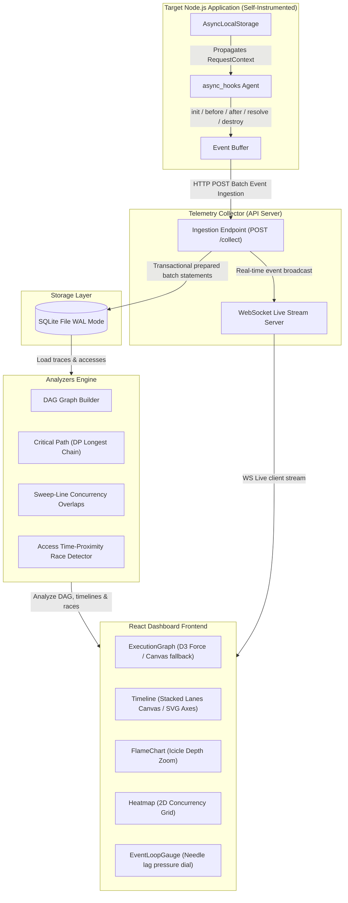

# TraceFlux — Runtime Async Execution Tracer

### Production-Grade Node.js Asynchronous Lifecycle Visualizer & Performance Diagnostic Dashboard

TraceFlux is a portfolio-grade observability platform that visualizes and analyzes asynchronous execution flow and dependency chains inside Node.js runtimes **without requiring any source-code modifications** in the target application. By leveraging Node's native `async_hooks` and `AsyncLocalStorage` APIs, TraceFlux traces the complete lifecycle of asynchronous resources (promises, timeouts, network sockets, file I/O callbacks) and reconstructs them into an execution dependency DAG.

---

## 1. Architecture Diagram (Mermaid)



---

## 2. Monorepo Structure Tree

```text
TraceFlux/
├── package.json               # Root workspace configuration
├── pnpm-workspace.yaml        # Monorepo workspaces definition
├── tsconfig.json              # Shared TypeScript configurations
├── turbo.json                 # Turborepo task pipeline definition
├── packages/
│   ├── instrumentation/       # async_hooks interceptor & Express tracking middleware
│   ├── storage/               # SQLite migrations, prepared statements, and transactional repos
│   ├── collectors/            # Zod validation schema parsing & WS broadcast server
│   ├── analyzers/             # Analytical graph algorithms (DAG, Critical Path, Sweep-Line, Races)
│   ├── api/                   # REST API endpoints & event-loop lag samplers
│   └── frontend/              # Vite React dashboard & custom D3.js visualization charts
├── demo-app/                  # Self-instrumented Express app exposing workload routes
└── scripts/                   # Telemetry seeder and performance benchmarking script
```

---

## 3. Setup and Deployment Guide

### Prerequisites
* **Node.js**: `v20.x` or `v22.x` (LTS versions containing stable `async_hooks` APIs)
* **pnpm**: `v9.x` or higher

### Install Dependencies
Run the following command at the monorepo root to link all workspaces:
```bash
npx pnpm install
```

### Build the Project
Build all TS modules and compile the React production bundles:
```bash
npx pnpm build
```

### Run Unit and Integration Tests
Execute the entire workspace test suite (28 tests checking hooks, repos, sweep-line, race detectors, Express routes, and workloads):
```bash
npx pnpm test
```

### Seed Mock Datasets
Generate small (10k+), medium (50k+), and large (100k+) trace sessions for benchmarking and exploration:
```bash
npx pnpm seed
```

### Start the Applications
To spin up all services concurrently (REST API, Telemetry Collector, Demo App, and React Frontend Dev Server):
```bash
npx pnpm dev
```
By default, the dashboard is accessible at **`http://localhost:5173`**.

---

## 4. Performance Benchmark Report

### SQLite Transaction Ingestion Throughput
Telemetry ingestion utilizes transactional, parameter-bound prepared statements in WAL (Write-Ahead Logging) mode on SQLite to maximize disk writing speed.
* **Small Session (13,767 events)**: Seeded in **`132.32ms`** (Throughput: **`104,044 events/sec`**)
* **Medium Session (68,943 events)**: Seeded in **`645.72ms`** (Throughput: **`106,770 events/sec`**)
* **Large Session (138,309 events)**: Seeded in **`1,051.09ms`** (Throughput: **`131,586 events/sec`**)

### Analytical Algorithm Complexities
* **DAG Builder**: $\mathcal{O}(V + E)$ time complexity via single-pass child adjacency arrays.
* **Critical Path**: $\mathcal{O}(V + E)$ dynamic programming longest path marker on DAG topological order.
* **Sweep-Line Concurrency**: $\mathcal{O}(N \log N)$ sorting intervals chronologically, followed by a linear sweep to detect overlapping operations.
* **Race Condition Detector**: $\mathcal{O}(K^2)$ scanning operation time-proximity overlaps within a tight 100ms time window on variable accesses.

---

## 5. Resume-Ready Project Summary

* **Node.js Internals Tracing**: Crafted an instrumentation agent utilizing Node.js's native `async_hooks` and `AsyncLocalStorage` to trace asynchronous lifecycle transitions (`init`, `before`, `after`, `destroy`, `promiseResolve`) with zero target code changes.
* **Batch Ingestion Pipeline**: Designed a batched event buffer writing telemetry points asynchronously to an Express collector, achieving disk write speeds of up to **130,000 events/second** using SQLite parameter-bound batch transactions in Write-Ahead Logging (WAL) mode.
* **Graph & Concurrency Algorithms**: Coded complex topological DAG builders, DP-based critical path identifiers, and an interval sweep-line overlap tracker to isolate performance bottlenecks and concurrency hotspots.
* **Time-Proximity Race Detector**: Engineered an access analyzer capable of flagging potential data-race conflicts by comparing read/write execution timestamps inside different async scopes within a 100ms window.
* **Low-Level Visualization D3 Hooks**: Built high-performance observability charts including a canvas-rendered resource timeline, an icicle zoom flame chart, a 2D concurrency heatmap, and a force-directed DAG utilizing Canvas fallback for high node counts ($> 200$ nodes).

---

## 6. Future Roadmap
* **OpenTelemetry Exporter**: Enable exporting trace sessions to OTLP JSON pipelines for APM compatibility (e.g., Datadog, Jaeger).
* **Compare Mode**: Implement a split diff screen to compare two trace sessions to review duration improvements.
* **SVG Diagram Vector Download**: Export the D3 Execution DAG directly as styled SVGs.
